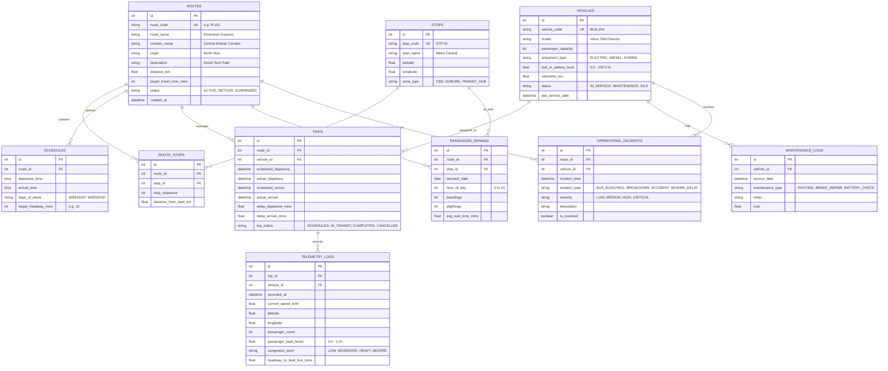

# CorridorIQ – Database Schema & Entity Relationships

---

### 1. Database Overview & Technology
* **Database Engine**: MySQL 8.0+
* **Storage Engine**: InnoDB (Foreign key constraints & ACID transactions)
* **Character Set**: `utf8mb4` / `utf8mb4_unicode_ci`
* **ORM**: SQLAlchemy 2.0 (Python) with `PyMySQL` driver
* **Design Pattern**: GTFS-inspired normalized relational schema with analytical aggregations.

---

### 2. Entity Relationship Diagram (ERD)



---

### 3. Detailed Table Definitions & SQL DDL

#### 3.1. Routes (`routes`)
Represents the designated corridors and lines operated across the network.
```sql
CREATE TABLE IF NOT EXISTS routes (
    id INT AUTO_INCREMENT PRIMARY KEY,
    route_code VARCHAR(32) NOT NULL UNIQUE,
    route_name VARCHAR(128) NOT NULL,
    corridor_name VARCHAR(128) NOT NULL,
    origin VARCHAR(128) NOT NULL,
    destination VARCHAR(128) NOT NULL,
    distance_km DECIMAL(6, 2) NOT NULL,
    target_travel_time_mins INT NOT NULL,
    status VARCHAR(32) NOT NULL DEFAULT 'ACTIVE',
    created_at TIMESTAMP DEFAULT CURRENT_TIMESTAMP,
    INDEX idx_corridor_name (corridor_name),
    INDEX idx_route_status (status)
) ENGINE=InnoDB DEFAULT CHARSET=utf8mb4;
```

#### 3.2. Stops (`stops`)
Physical transit stops/stations with coordinates.
```sql
CREATE TABLE IF NOT EXISTS stops (
    id INT AUTO_INCREMENT PRIMARY KEY,
    stop_code VARCHAR(32) NOT NULL UNIQUE,
    stop_name VARCHAR(128) NOT NULL,
    latitude DECIMAL(9, 6) NOT NULL,
    longitude DECIMAL(9, 6) NOT NULL,
    zone_type VARCHAR(64) DEFAULT 'SUBURB',
    INDEX idx_coordinates (latitude, longitude)
) ENGINE=InnoDB DEFAULT CHARSET=utf8mb4;
```

#### 3.3. Route Stops Mapping (`route_stops`)
Maintains sequential order and spatial distance along a specific route.
```sql
CREATE TABLE IF NOT EXISTS route_stops (
    id INT AUTO_INCREMENT PRIMARY KEY,
    route_id INT NOT NULL,
    stop_id INT NOT NULL,
    stop_sequence INT NOT NULL,
    distance_from_start_km DECIMAL(6, 2) NOT NULL DEFAULT 0.00,
    CONSTRAINT fk_route_stops_route FOREIGN KEY (route_id) REFERENCES routes(id) ON DELETE CASCADE,
    CONSTRAINT fk_route_stops_stop FOREIGN KEY (stop_id) REFERENCES stops(id) ON DELETE CASCADE,
    UNIQUE KEY uq_route_sequence (route_id, stop_sequence),
    INDEX idx_stop_lookup (stop_id)
) ENGINE=InnoDB DEFAULT CHARSET=utf8mb4;
```

#### 3.4. Vehicles (`vehicles`)
The physical fleet inventory, motor/propulsion type, telemetry state, and health.
```sql
CREATE TABLE IF NOT EXISTS vehicles (
    id INT AUTO_INCREMENT PRIMARY KEY,
    vehicle_code VARCHAR(32) NOT NULL UNIQUE,
    model VARCHAR(128) NOT NULL,
    passenger_capacity INT NOT NULL DEFAULT 60,
    propulsion_type ENUM('ELECTRIC', 'DIESEL', 'HYBRID') NOT NULL DEFAULT 'DIESEL',
    fuel_or_battery_level DECIMAL(5, 2) NOT NULL DEFAULT 100.00,
    odometer_km DECIMAL(10, 2) NOT NULL DEFAULT 0.00,
    status ENUM('IN_SERVICE', 'MAINTENANCE', 'IDLE') NOT NULL DEFAULT 'IDLE',
    last_service_date DATE,
    created_at TIMESTAMP DEFAULT CURRENT_TIMESTAMP,
    INDEX idx_vehicle_status (status),
    INDEX idx_propulsion (propulsion_type)
) ENGINE=InnoDB DEFAULT CHARSET=utf8mb4;
```

#### 3.5. Schedules (`schedules`)
Fixed timetable baselines with target headway intervals.
```sql
CREATE TABLE IF NOT EXISTS schedules (
    id INT AUTO_INCREMENT PRIMARY KEY,
    route_id INT NOT NULL,
    departure_time TIME NOT NULL,
    arrival_time TIME NOT NULL,
    days_of_week VARCHAR(32) NOT NULL DEFAULT 'WEEKDAY',
    target_headway_mins INT NOT NULL DEFAULT 15,
    CONSTRAINT fk_schedules_route FOREIGN KEY (route_id) REFERENCES routes(id) ON DELETE CASCADE,
    INDEX idx_schedule_route_time (route_id, departure_time)
) ENGINE=InnoDB DEFAULT CHARSET=utf8mb4;
```

#### 3.6. Trips (`trips`)
Instantiated active or historical scheduled trips paired with a specific vehicle.
```sql
CREATE TABLE IF NOT EXISTS trips (
    id INT AUTO_INCREMENT PRIMARY KEY,
    route_id INT NOT NULL,
    vehicle_id INT NOT NULL,
    scheduled_departure DATETIME NOT NULL,
    actual_departure DATETIME,
    scheduled_arrival DATETIME NOT NULL,
    actual_arrival DATETIME,
    delay_departure_mins DECIMAL(6, 2) DEFAULT 0.00,
    delay_arrival_mins DECIMAL(6, 2) DEFAULT 0.00,
    trip_status ENUM('SCHEDULED', 'IN_TRANSIT', 'COMPLETED', 'CANCELLED') NOT NULL DEFAULT 'SCHEDULED',
    CONSTRAINT fk_trips_route FOREIGN KEY (route_id) REFERENCES routes(id) ON DELETE CASCADE,
    CONSTRAINT fk_trips_vehicle FOREIGN KEY (vehicle_id) REFERENCES vehicles(id) ON DELETE CASCADE,
    INDEX idx_trip_departure (scheduled_departure),
    INDEX idx_trip_status (trip_status)
) ENGINE=InnoDB DEFAULT CHARSET=utf8mb4;
```

#### 3.7. Telemetry Logs (`telemetry_logs`)
Periodic telemetry broadcasted by buses in transit (speed, load, headway, congestion).
```sql
CREATE TABLE IF NOT EXISTS telemetry_logs (
    id BIGINT AUTO_INCREMENT PRIMARY KEY,
    trip_id INT NOT NULL,
    vehicle_id INT NOT NULL,
    recorded_at DATETIME NOT NULL,
    current_speed_kmh DECIMAL(5, 2) NOT NULL DEFAULT 0.00,
    latitude DECIMAL(9, 6) NOT NULL,
    longitude DECIMAL(9, 6) NOT NULL,
    passenger_count INT NOT NULL DEFAULT 0,
    passenger_load_factor DECIMAL(4, 2) NOT NULL DEFAULT 0.00,
    congestion_level ENUM('LOW', 'MODERATE', 'HEAVY', 'SEVERE') NOT NULL DEFAULT 'LOW',
    headway_to_lead_bus_mins DECIMAL(5, 2),
    CONSTRAINT fk_telemetry_trip FOREIGN KEY (trip_id) REFERENCES trips(id) ON DELETE CASCADE,
    CONSTRAINT fk_telemetry_vehicle FOREIGN KEY (vehicle_id) REFERENCES vehicles(id) ON DELETE CASCADE,
    INDEX idx_recorded_at (recorded_at),
    INDEX idx_trip_recorded (trip_id, recorded_at)
) ENGINE=InnoDB DEFAULT CHARSET=utf8mb4;
```

#### 3.8. Passenger Demand Metrics (`passenger_demand_metrics`)
Aggregated passenger boardings and wait times per stop and hour.
```sql
CREATE TABLE IF NOT EXISTS passenger_demand_metrics (
    id INT AUTO_INCREMENT PRIMARY KEY,
    route_id INT NOT NULL,
    stop_id INT NOT NULL,
    demand_date DATE NOT NULL,
    hour_of_day TINYINT NOT NULL,
    boardings INT NOT NULL DEFAULT 0,
    alightings INT NOT NULL DEFAULT 0,
    avg_wait_time_mins DECIMAL(5, 2) NOT NULL DEFAULT 0.00,
    CONSTRAINT fk_demand_route FOREIGN KEY (route_id) REFERENCES routes(id) ON DELETE CASCADE,
    CONSTRAINT fk_demand_stop FOREIGN KEY (stop_id) REFERENCES stops(id) ON DELETE CASCADE,
    UNIQUE KEY uq_route_stop_hour (route_id, stop_id, demand_date, hour_of_day),
    INDEX idx_demand_date_hour (demand_date, hour_of_day)
) ENGINE=InnoDB DEFAULT CHARSET=utf8mb4;
```

#### 3.9. Operational Incidents (`operational_incidents`)
Detected irregularities, delays, bus bunching events, and mechanical failures.
```sql
CREATE TABLE IF NOT EXISTS operational_incidents (
    id INT AUTO_INCREMENT PRIMARY KEY,
    route_id INT,
    vehicle_id INT,
    incident_time DATETIME NOT NULL,
    incident_type ENUM('BUS_BUNCHING', 'BREAKDOWN', 'ACCIDENT', 'SEVERE_DELAY', 'OVERCROWDING') NOT NULL,
    severity ENUM('LOW', 'MEDIUM', 'HIGH', 'CRITICAL') NOT NULL DEFAULT 'MEDIUM',
    description TEXT NOT NULL,
    is_resolved BOOLEAN NOT NULL DEFAULT FALSE,
    CONSTRAINT fk_incidents_route FOREIGN KEY (route_id) REFERENCES routes(id) ON DELETE SET NULL,
    CONSTRAINT fk_incidents_vehicle FOREIGN KEY (vehicle_id) REFERENCES vehicles(id) ON DELETE SET NULL,
    INDEX idx_incident_time (incident_time),
    INDEX idx_severity_resolved (severity, is_resolved)
) ENGINE=InnoDB DEFAULT CHARSET=utf8mb4;
```

---

### 4. Synthetic Data Generation Strategy
The synthetic data generator (`data_generator.py`) produces statistically realistic transit datasets:
1. **5 Diverse Urban Corridors**:
   - `R-101`: Central Business District Spine (High frequency, severe rush-hour bunching).
   - `R-202`: University & Medical Transitway (High peak-hour passenger boarding).
   - `R-303`: Tech Campus Shuttle Line (High electric bus deployment, battery telemetry).
   - `R-404`: East-West Suburban Connector (Long route, weather/traffic delay propagation).
   - `R-505`: Airport / Intermodal Expressway (High luggage demand, high speed variations).
2. **25 Realistic Transit Vehicles**:
   - Mix of Electric (30%), Hybrid (30%), and Clean Diesel (40%).
   - Dynamic battery/fuel levels, odometer readings, and simulated maintenance warnings.
3. **50+ Stops & Timetables**:
   - Spatially coherent GPS coordinates simulating a realistic metropolitan corridor.
4. **Hourly Passenger Demand Profiles**:
   - Distinct morning rush (07:00-09:30), evening rush (16:30-19:00), and midday base patterns.
5. **Algorithmic Anomaly Injection**:
   - Bus bunching scenarios (two consecutive buses on Route 101 separated by < 2.5 minutes).
   - Bottlenecks with elevated delay indices (> 18 minutes) and high passenger load factors (> 1.15).

