# CorridorIQ – One-Day Development & Implementation Plan

---

### 1. Overview & Timeline Strategy

This plan organizes the complete build of **CorridorIQ** into an achievable, structured 5-phase schedule (approx. 8–9 hours total). Each phase includes clear deliverables, verification checkpoints, and zero fluff.

```mermaid
gantt
    title CorridorIQ One-Day Implementation Timeline
    dateFormat  HH:mm
    axisFormat %H:%M

    section Phase 1: DB & Backend Core
    Environment & Config Setup       :09:00, 45m
    SQLAlchemy Models & DB Connect   :09:45, 75m

    section Phase 2: Engine & REST APIs
    Synthetic Data Generator Script  :11:00, 60m
    REST Endpoints (Routes/Fleet/Analytics) :12:00, 60m

    section Lunch Break
    Break                            :13:00, 45m

    section Phase 3: AI Agent Integration
    Gemini Client & Tool Registry    :13:45, 60m
    Agent Chat Loop & Diagnostics    :14:45, 45m

    section Phase 4: Frontend Development
    Vite + Tailwind + Layout Setup   :15:30, 45m
    Dashboard & Corridor Recharts    :16:15, 60m
    Agent Studio Interactive UI      :17:15, 45m

    section Phase 5: Verification & Polish
    End-to-End Testing & Verification :18:00, 45m
    Final Polish & Documentation     :18:45, 30m
```



---

### 2. Hourly Phase Breakdown

#### Phase 1: Environment Setup, Database & Backend Core (09:00 – 11:00)
* **Goal**: Prepare MySQL database connection, project configuration, and SQLAlchemy models.
* **Tasks**:
  1. Initialize Python virtual environment (`.venv`) and install dependencies.
  2. Create `backend/app/config.py` with Pydantic Settings reading from `.env`.
  3. Create `backend/app/database.py` with SQLAlchemy engine and session factory.
  4. Build ORM models (`routes`, `stops`, `route_stops`, `vehicles`, `schedules`, `trips`, `telemetry_logs`, `passenger_demand_metrics`, `operational_incidents`).
  5. Test connection and verify table auto-creation on database initialization.
* **Checkpoint**: Running a test script connects to MySQL and creates all 9 tables with zero errors.

#### Phase 2: Synthetic Data Engine & REST API Endpoints (11:00 – 13:00)
* **Goal**: Build realistic transit data generator and implement clean FastAPI endpoints.
* **Tasks**:
  1. Build `backend/app/services/data_generator.py`:
     - Creates 5 realistic urban transit corridors (`R-101` to `R-505`).
     - Populates 50 stops, 25 vehicles (Electric, Hybrid, Diesel), and schedules.
     - Simulates realistic morning and evening peak passenger demand curves.
     - Seeds active trips with deliberate bus bunching and delay bottlenecks for testing.
  2. Implement FastAPI routers:
     - `GET /api/v1/routes` & `GET /api/v1/routes/{id}`
     - `GET /api/v1/vehicles` & `GET /api/v1/vehicles/{id}`
     - `GET /api/v1/analytics/overview` & `GET /api/v1/analytics/bottlenecks`
     - `POST /api/v1/seed/generate`
  3. Add CORS middleware and test via FastAPI interactive docs (`/docs`).
* **Checkpoint**: Opening `http://localhost:8000/docs` allows testing all endpoints and viewing populated seed data.

#### Phase 3: AI Agent & Tool Calling Integration (13:45 – 15:30)
* **Goal**: Integrate Google Gemini API with native tool calling for transit operations.
* **Tasks**:
  1. Build `backend/app/agent/tools.py` implementing the 5 transit operations tools:
     - `get_network_delay_hotspots`
     - `detect_bus_bunching`
     - `get_fleet_health_and_battery`
     - `get_corridor_passenger_demand`
     - `prescribe_dispatch_intervention`
  2. Configure `backend/app/agent/gemini_client.py` and `executor.py` to handle the multi-turn function call loop.
  3. Connect `/api/v1/agent/chat` endpoint to return conversational answers alongside structured tool execution traces.
  4. Test edge cases (e.g., questions requiring multiple tool calls).
* **Checkpoint**: Sending a POST request to `/api/v1/agent/chat` with *"What is causing delays on R-101 and how can we fix it?"* invokes `detect_bus_bunching` and returns concrete dispatch guidance.

#### Phase 4: Modern React Frontend (15:30 – 18:00)
* **Goal**: Build a responsive, modular UI using React, Vite, Tailwind CSS, and Recharts.
* **Tasks**:
  1. Scaffold React + Vite in `frontend/`, configure Tailwind CSS and Lucide icons.
  2. Implement navigation layout: Header with network status indicator, sidebar navigation.
  3. Build **Executive Dashboard Page**:
     - KPI cards (OTP rate, active buses, severe delays, fleet alert count).
     - Bottleneck and Bus Bunching alert list with severity tags.
     - Recharts delay timeline and hourly ridership distribution.
  4. Build **Corridors Page**:
     - Route selector with corridor performance metrics.
     - Stop-by-stop visual progression bar and passenger load profile.
  5. Build **Fleet Page**:
     - Vehicle cards showing battery/fuel meter, status badge, and propulsion type.
  6. Build **Agent Studio Page / Drawer**:
     - Interactive chat interface for operators to prompt the Gemini agent.
     - Accordion showing executed tools, inputs, and database outputs.
* **Checkpoint**: Web UI loads at `http://localhost:5173`, navigates smoothly, renders Recharts with real backend data, and allows chatting with the AI agent.

#### Phase 5: Verification, Testing & Polish (18:00 – 19:15)
* **Goal**: Ensure robustness, clean logs, and seamless developer onboarding.
* **Tasks**:
  1. Run end-to-end user flows (filter fleet, check corridor delays, ask AI agent for recommendations).
  2. Verify error handling when MySQL is empty (graceful "seed data" prompt) or when Gemini API key is missing.
  3. Create clean documentation with simple start commands (`README.md`).
* **Checkpoint**: Clean single-command setups for backend and frontend with zero console errors.

---

### 3. Dependencies & Installation Commands

#### 3.1. Backend Dependencies (`backend/requirements.txt`)
```text
fastapi>=0.115.0
uvicorn[standard]>=0.30.0
sqlalchemy>=2.0.30
pymysql>=1.1.0
cryptography>=43.0.0
pydantic>=2.8.0
pydantic-settings>=2.4.0
python-dotenv>=1.0.1
google-genai>=1.0.0
faker>=28.0.0
```

#### 3.2. Backend Installation & Run Commands (Windows PowerShell)
```powershell
# 1. Navigate to backend directory
cd backend

# 2. Create and activate Python virtual environment
python -m venv .venv
.\.venv\Scripts\Activate.ps1

# 3. Install dependencies
pip install -r requirements.txt

# 4. Copy environment configuration and edit credentials
Copy-Item .env.example .env
# Set DB_USER, DB_PASSWORD, DB_HOST, DB_NAME, and GEMINI_API_KEY in .env

# 5. Seed database with synthetic data
python scripts/seed_database.py

# 6. Start the FastAPI development server
uvicorn app.main:app --reload --port 8000
```

#### 3.3. Frontend Dependencies (`frontend/package.json`)
* **Core**: `react`, `react-dom`
* **Build**: `vite`, `@vitejs/plugin-react`
* **Styling**: `tailwindcss`, `postcss`, `autoprefixer`
* **Visualization**: `recharts`
* **Icons & HTTP**: `lucide-react`, `axios`

#### 3.4. Frontend Installation & Run Commands (Windows PowerShell)
```powershell
# 1. Navigate to frontend directory
cd frontend

# 2. Install npm packages
npm install

# 3. Copy environment configuration
Copy-Item .env.example .env

# 4. Start the Vite development server
npm run dev
```

