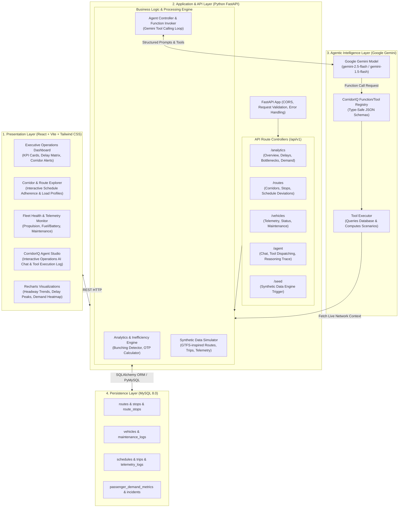

# CorridorIQ – Agentic Transport Operations Intelligence Platform
## Complete System Architecture Specification

---

### 1. Executive Summary & Vision

**CorridorIQ** is an enterprise-grade, agentic intelligence platform engineered for municipal and regional transport authorities, fleet controllers, and corridor managers. It bridges the gap between raw transit telematics and proactive operations management by combining:

1. **Real-time Corridor Telematics & Analytics**: Route health, vehicle positioning, headway variance, schedule adherence, delay propagation, and passenger load factors.
2. **Synthetic Operational Data Simulator**: Realistic generation of urban transit networks (buses, multi-stop corridors, timetables, passenger tap-in/outs, and traffic disruption incidents).
3. **Autonomous AI Transport Controller (Agent)**: Grounded in **Google Gemini API** with native tool/function calling to autonomously query operational data, identify bottlenecks (such as bus bunching and corridor overloading), and prescribe corrective dispatch decisions.

---

### 2. High-Level System Architecture Diagram



---

### 3. Core Architectural Components

#### 3.1. Frontend Architecture (React + Vite + Tailwind CSS + Recharts)
* **Design Philosophy**: Single-Page Application (SPA) structured with high modularity, atomic components, and separation of concerns between presentation, state, and API communication.
* **Key Modules**:
  * **Operations Dashboard**: Summary metrics (Network On-Time Performance (OTP), Active Fleet Utilization, Corridor Congestion Index, Delay Hotspots).
  * **Route & Corridor Explorer**: Deep dive into individual corridors, comparing scheduled vs. actual arrival times, headway adherence, and station-by-station passenger accumulation.
  * **Fleet Telemetry Monitor**: Visual cards and data tables displaying vehicle battery/fuel levels, speed, occupancy, and diagnostic alerts.
  * **Agent Studio / Co-Pilot Panel**: Dedicated interface allowing transport operators to issue operational queries in natural language, view tool-call arguments and responses, and approve recommended dispatch actions.
* **Visual Components**: Recharts for time-series delay graphs, corridor load profiles, and bar charts for fleet efficiency.

#### 3.2. Backend Architecture (Python FastAPI)
* **Design Philosophy**: Asynchronous, strongly-typed RESTful architecture with Pydantic v2 validation, modular routing, and clean service-layer abstractions.
* **Component Breakdown**:
  * `app/core/config.py`: Environment-driven settings using Pydantic Settings (CORS origins, MySQL connection strings, Gemini API configuration).
  * `app/database.py`: SQLAlchemy engine, session management with connection pooling, and declarative base.
  * `app/models/`: Declarative SQLAlchemy models reflecting the relational transport data model.
  * `app/schemas/`: Input and output Pydantic schemas enforcing strict contract boundaries.
  * `app/services/`: Pure business logic decoupled from HTTP request objects for simple unit testing and reuse by the AI Agent tools.
  * `app/agent/`: Gemini API orchestrator, tool registry, function declaration schemas, and conversational state handler.

#### 3.3. Database Architecture (MySQL)
* **Design Philosophy**: 3rd Normal Form (3NF) relational design modeled after transit industry standards (inspired by GTFS - General Transit Feed Specification).
* **Storage Optimization**: Strategic indexing on foreign keys, time ranges (`timestamp`, `scheduled_departure`), and corridor lookups for sub-millisecond analytical aggregations.

#### 3.4. AI Agentic Architecture (Gemini Function Calling)
* **Design Philosophy**: The AI agent acts not merely as a conversational chatbot, but as an **Autonomous Transport Controller**.
* **Flow of Execution**:
  1. Operator submits a query (e.g., *"Why is Route 101 delayed, and which buses are experiencing bunching?"*).
  2. Agent Service attaches transport system prompts and registers Python operational tools with Gemini.
  3. Gemini analyzes the question and emits tool-call instructions (e.g., `get_route_delays(route_code='R-101')`, `detect_bus_bunching(route_code='R-101')`).
  4. Backend executes the requested functions directly against the database via service layers.
  5. Backend submits the structured tool results back to Gemini.
  6. Gemini processes the ground-truth data and generates an executive operations diagnosis with actionable recommendations.

---

### 4. Scalable Folder Structure

```
corridor-iq/
├── backend/
│   ├── app/
│   │   ├── __init__.py
│   │   ├── main.py                     # FastAPI application bootstrap & CORS
│   │   ├── config.py                   # Pydantic Settings & environment variables
│   │   ├── database.py                 # SQLAlchemy engine, sessionmaker, Base
│   │   ├── models/                     # SQLAlchemy ORM definitions
│   │   │   ├── __init__.py
│   │   │   ├── route.py                # Route, Stop, RouteStop
│   │   │   ├── vehicle.py              # Vehicle, MaintenanceLog
│   │   │   ├── trip.py                 # Schedule, Trip, TelemetryLog
│   │   │   └── analytics.py            # PassengerDemand, Incident
│   │   ├── schemas/                    # Pydantic v2 data validation models
│   │   │   ├── __init__.py
│   │   │   ├── route_schema.py
│   │   │   ├── vehicle_schema.py
│   │   │   ├── analytics_schema.py
│   │   │   └── agent_schema.py
│   │   ├── api/
│   │   │   ├── __init__.py
│   │   │   └── v1/
│   │   │       ├── __init__.py
│   │   │       ├── router.py           # Master v1 router aggregating all endpoints
│   │   │       ├── endpoints_routes.py
│   │   │       ├── endpoints_vehicles.py
│   │   │       ├── endpoints_analytics.py
│   │   │       ├── endpoints_agent.py
│   │   │       └── endpoints_seed.py
│   │   ├── services/                   # Modular domain business logic
│   │   │   ├── __init__.py
│   │   │   ├── route_service.py        # Route & stop query logic
│   │   │   ├── vehicle_service.py      # Fleet health & telemetry logic
│   │   │   ├── analytics_service.py    # Delay calculation, bunching, OTP
│   │   │   └── data_generator.py       # Realistic synthetic data generator
│   │   └── agent/                      # Gemini AI Agent module
│   │       ├── __init__.py
│   │       ├── gemini_client.py        # Gemini SDK initialization & wrapper
│   │       ├── prompts.py              # System prompts & controller guidelines
│   │       ├── tools.py                # Transport tool functions & JSON declarations
│   │       └── executor.py             # Multi-turn tool execution loop
│   ├── scripts/
│   │   ├── seed_database.py            # CLI script to populate DB with realistic data
│   │   └── verify_agent.py             # CLI test harness for agent tools
│   ├── tests/
│   │   └── __init__.py
│   ├── requirements.txt
│   ├── .env.example
│   └── README.md
│
├── frontend/
│   ├── public/
│   │   └── vite.svg
│   ├── src/
│   │   ├── assets/
│   │   ├── components/
│   │   │   ├── common/                 # Navbar, Sidebar, StatCard, Badge, Loader
│   │   │   ├── dashboard/              # Overview KPI grid, delay alerts
│   │   │   ├── corridors/              # Corridor selector, route timeline, load chart
│   │   │   ├── fleet/                  # Vehicle card, battery/fuel meter, status tag
│   │   │   └── agent/                  # Chat drawer, message bubble, tool-call viewer
│   │   ├── pages/
│   │   │   ├── DashboardPage.jsx       # Operations control center view
│   │   │   ├── CorridorsPage.jsx       # Route and station analysis
│   │   │   ├── FleetPage.jsx           # Fleet maintenance & telemetry monitor
│   │   │   └── AgentStudioPage.jsx     # Full-page interactive AI agent studio
│   │   ├── services/
│   │   │   └── api.js                  # Axios client configured with base URL
│   │   ├── context/
│   │   │   └── AppContext.jsx          # Global network refresh & filter state
│   │   ├── App.jsx                     # Route configuration & layout wrapper
│   │   ├── main.jsx                    # React root entry
│   │   └── index.css                   # Tailwind CSS styling directives
│   ├── index.html
│   ├── package.json
│   ├── vite.config.js
│   ├── tailwind.config.js
│   ├── postcss.config.js
│   └── .env.example
│
├── docs/
│   ├── SYSTEM_ARCHITECTURE.md          # This document
│   ├── DATABASE_SCHEMA.md              # Detailed schema, relationships, indexes
│   ├── API_AND_AGENT_SPEC.md           # OpenAPI endpoints & Gemini tool declarations
│   └── ONE_DAY_IMPLEMENTATION_PLAN.md  # Hourly roadmap with checkpoints
├── .gitignore
└── README.md
```

---

### 5. Architectural Quality Attributes

| Quality Attribute | Architectural Strategy |
| :--- | :--- |
| **Modularity** | Decoupled UI components, separate API routes, isolated database services, and a standalone AI tool registry. |
| **Maintainability** | Pydantic data contracts at API boundaries ensure type safety and explicit schemas. |
| **Debuggability** | Structured logging, clear HTTP status codes, explicit error payloads, and exposed tool-call execution logs in the AI Agent response. |
| **Security** | Zero hardcoded secrets; API keys and database credentials strictly loaded via `.env` files; parameterized queries via SQLAlchemy prevent SQL injection. |
| **Extensibility** | Transit schema aligns with GTFS patterns, allowing future ingestion of real-world GTFS-RT feeds without altering downstream analytics. |

