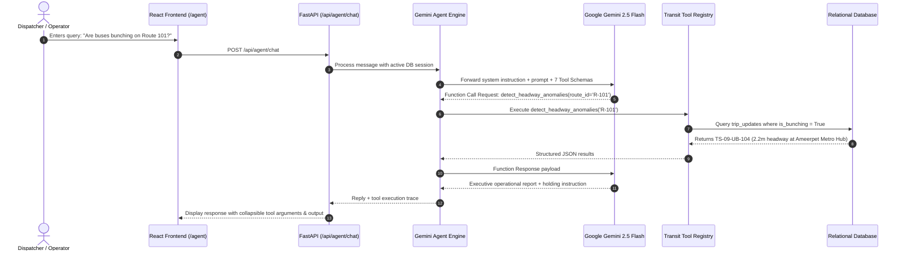

# CorridorIQ — AI Agent Workflow & Tool Calling Architecture
## Model: Google Gemini 2.5 Flash via official `google-genai` Python SDK

---

### 1. Operational Persona & Mission

The CorridorIQ AI Agent acts as an **Autonomous Transport Operations Controller & Dispatch Strategist** stationed at the **Hyderabad Metropolitan Transport Operations Center**.

The agent is instructed to:
1. Ground every diagnostic assertion in real database queries executed via tools.
2. Formulate actionable dispatch interventions (holding buses, short-turning trips, deploying relief vehicles).
3. Distinguish between **Observed Facts** (retrieved from tools), **Hypotheses** (likely cause), and **Proposed Interventions**.
4. Strictly respect security boundaries (never run raw SQL, never alter live vehicle feeds without controller sign-off).

---

### 2. Multi-Turn Tool Calling Sequence Diagram

---

### 3. The 7 Operational Tools

| Tool Name | Parameters | Purpose |
| :--- | :--- | :--- |
| `get_route_performance` | `route_id`, `start_date`, `end_date` | Queries OTP %, average delay, and trip count for corridors. |
| `get_vehicle_positions` | `route_id` | Fetches real-time simulated GPS positions, speeds, and occupancies. |
| `detect_headway_anomalies` | `route_id`, `time_window` | Scans for bus bunching (headway $\le 35\%$ target) and service gaps ($\ge 180\%$). |
| `analyze_passenger_demand` | `route_id`, `time_window` | Computes hourly boardings, morning/evening peaks, and overcrowding alerts. |
| `get_delay_analysis` | `route_id`, `time_window` | Analyzes network-wide delay distributions and bottleneck corridors. |
| `compare_routes` | `route_ids` | Compares operational punctuality and demand across multiple routes. |
| `create_dispatch_recommendation` | `route_id`, `issue_type`, `explanation`, `proposed_action`, `priority` | Creates a new formal dispatch recommendation in the database for human review. |

---

### 4. Graceful Degradation & Fallback

If `GEMINI_API_KEY` is not set:
- The system gracefully utilizes a **local deterministic tool dispatcher**.
- It queries the **exact same real database tools** (`detect_headway_anomalies`, `get_delay_analysis`, etc.).
- It formats an authentic operational briefing and includes an honest notice informing the user that setting `GEMINI_API_KEY` in `backend/.env` unlocks full conversational synthesis.
- Non-AI dashboards, maps, charts, and dispatch review buttons remain 100% operational.

