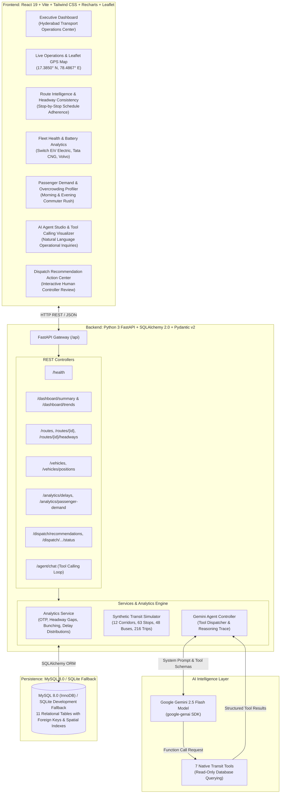

# CorridorIQ — System Architecture Specification
## Operating Region: Hyderabad, Telangana, India

---

### 1. Executive Summary

**CorridorIQ** is an enterprise-grade agentic transport operations platform engineered for municipal transit controllers, fleet managers, and corridor dispatchers in the **Hyderabad Metropolitan Region (Telangana, India)**.

It pairs high-throughput relational transit telematics with **Google Gemini 2.5 Flash** native function calling to detect bus bunching, calculate schedule deviation, analyze commuter surges across Metro interchanges (Ameerpet, Miyapur, Hitech City), and prescribe operational dispatch actions.

---

### 2. High-Level Architecture Diagram

---

### 3. Architecture Pillars

1. **Deterministic Grounding**:
   - The AI agent never performs arbitrary SQL queries or direct database mutations.
   - All analytical calculations (OTP, Headways, Delays) are calculated by verified Python service methods.
2. **Human-in-the-Loop Dispatch**:
   - The AI agent can *formulate* and *queue* dispatch recommendations, but cannot unilaterally alter vehicle schedules.
   - Transit dispatchers review, approve, reject, or resolve interventions via the `/api/dispatch/recommendations` endpoints.
3. **Regional Realism (Hyderabad, Telangana)**:
   - Centered around Hyderabad landmarks: Cyber Towers, Ameerpet Metro Hub, Tolichowki Flyover, Gachibowli Stadium, LB Nagar Ring Road.
   - IST Timezone (UTC+5:30), INR (₹) currency, DD-MM-YYYY dates.
   - Clearly disclosed synthetic data simulation.
4. **Dual-Dialect Database Layer**:
   - Production-ready MySQL 8.0 schema with foreign key constraints.
   - Zero-configuration SQLite development fallback (`corridoriq.db`) allowing instant local demonstration without external database servers.

