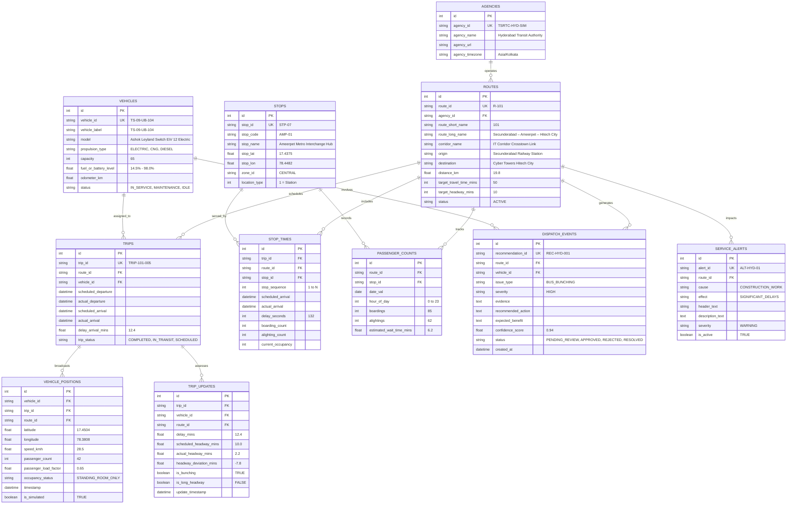

# CorridorIQ — GTFS-Inspired Database Schema Specification
## Target Database: MySQL 8.0 (InnoDB) with SQLite Fallback

---

### 1. Relational Entity Relationship Diagram (ERD)

---

### 2. Operational Extension Design

Unlike standard static GTFS feeds, CorridorIQ incorporates **Operational Telematics Extensions**:
1. **Dynamic Headway Deviations**: Headways are computed sequentially per stop and corridor, flagging bus bunching when actual headway is $\le 35\%$ of scheduled headway.
2. **Occupancy Status**: Passenger load factors exceeding 90% are automatically categorized as `STANDING_ROOM_ONLY` or `CRUSHED_STANDING_ROOM`.
3. **Dispatch Audit Logs**: Every corrective suggestion by the AI controller is recorded in `dispatch_events` with confidence scores and human status transitions.

